

**软件工程 · 实验二　软件设计与建模**

# 酒店预订系统的软件设计与建模

**学号**：241220024　　**姓名**：陈一帆

**项目**：酒店预订系统（课程给定项目 4，实验一需求基线 REQ-001 ~ REQ-027）

**仓库**：https://github.com/ChenYiFanAccount/softeng-lab1-requirements

**日期**：2026 年 11 月 13 日

## 目录

- 第 1 章　项目与需求范围
- 第 2 章　软件的主要功能
- 第 3 章　软件架构设计
  - 3.1　架构选型与取舍
  - 3.2　分层与依赖方向
  - 3.3　模块划分
  - 3.4　模块间的交互
  - 3.5　八张图的逐张解读
- 第 4 章　数据设计
- 第 5 章　非功能设计
- 第 6 章　界面设计
- 第 7 章　AI 辅助设计过程（见 S8）
- 第 8 章　关于 AI 参与软件设计的思考（见 S8）
- 附录 A　需求条目全文（REQ-001 ~ REQ-027）

## 第1章　项目与需求范围

### 1.1　项目一句话

本项目是一个**单体部署、按业务能力纵切模块**的酒店预订系统：顾客查得到房、订得下房、改得了期；酒店按「房型 × 日期」维护库存与价格、确认订单、办理入住退房；平台管理员审核入驻、维护节假日字典、查审计日志。系统一期**不做在线支付**（REQ-022），但库存与订单的一致性必须做到**超卖次数 = 0**（REQ-019）。

### 1.2　需求来源与冻结口径

需求基线来自实验一的 27 条已确认需求（功能 22 条、非功能 4 条、约束 1 条），编号 REQ-001 ~ REQ-027 唯一且不重排。实验二的全部设计都以这份基线为准，凡是设计过程中发现基线本身有歧义的地方，一律回到需求原文裁定，并把裁定结果写进设计基线，而不是"先按代码写、回头补文档"。

全文涉及的四个关键口径先在这里定死，后面各章不再重复解释：

| 口径 | 定义 | 出处 |
|---|---|---|
| 六状态 / 八条边 | 订单有 待确认、已确认、已入住、已退房、已取消、未入住 六个状态；合法转换 **8 条边**，落在 **6 种状态对**上（T2/T3 同对、T4/T5 同对，各自拆两条是因为触发者与判据不同） | `01 §2`、图 3-5 |
| 库存三值 | `可售间数`＝酒店按日挂牌的可售量（可独立下调，如维修封房）；`已占用间数`＝有效订单占用；`余量 = 可售 − 已占用`（派生，不落库） | `03 §5`、图 3-1 |
| 下单只加占用 | 下单/取消只改「已占用」，**不动「可售」**；改可售时校验「不低于该日已占用」 | `03 §5`、图 3-7 |
| 一单多晚价 | 价格按「房型 × 日期」维护，故一单跨多晚单价不同 → 逐晚写 `booking_night` 快照，总价 = Σ(单价 × 间数) | `03 §2.7`、图 3-1 |

### 1.3　角色与边界

四类角色：**游客**（未登录，只能查酒店与余量）、**顾客**（自助注册，只能看自己的订单）、**酒店工作人员**（账号由入驻审核创建，只能操作本酒店）、**平台管理员**（审核、字典、审计、运维，但**不改业务数据本身**）。越权一律 403 并留痕，这是 REQ-001 与 REQ-020 的同一条要求在两个层次上的表达。

一期的边界写在 REQ-022：不做在线支付与退款、评价、积分、优惠券、连锁集团统一管理、移动端。因此界面上的"应付金额"只是展示值，取消时也没有真实退款动作——这一点在第 6 章会再说明一次，避免把"没有支付"读成"漏了功能"。

### 1.4　设计输入清单

设计不是凭印象画的，每一张图、每一张表都能指回下面这些输入：

- 需求基线：`exp1/requirements.md`（27 条，附录 A 全文）
- 项目参数：`exp1/项目参数.md`（六状态、允许/禁止转换、12 条异常、唯一约束、半开区间 `[入住日, 退房日)`)
- 访谈与修订记录：`exp1/甲方需求陈述_第一轮~第三轮.md`、`exp1/chat.txt`（INT-01~05、REV-001~003）
- 设计基线：`exp2/设计基线/01_术语与追溯.md`、`02_模块划分与交互.md`、`03_数据设计.md`

## 第2章　软件的主要功能

### 2.1　功能全景

系统按业务能力切成 10 个模块（M1–M10），另有两个技术支撑件（页面入口、数据存储）。模块不是按技术分层硬切的，而是**按事务边界切**：一个用户动作跨模块时，只有一个模块负责"决策"，其余模块只做配合。第三章会解释为什么这样切；本章只说"有哪些功能、分别归谁"。

表 2-1　模块与功能对照（REQ 编号对应附录 A）

| 模块 | 主要功能 | 覆盖 REQ |
|---|---|---|
| M1 账号与权限 | 注册、登录、角色判定、越权拦截 | REQ-001、REQ-020、REQ-026 |
| M2 酒店与房型 | 酒店与房型资料维护、入驻申请与审核 | REQ-002、REQ-025 |
| M3 库存与价格 | 每日库存（可售/已占用）、每日价格、停售与停业、节假日字典 | REQ-003、REQ-012、REQ-024、REQ-027 |
| M4 搜索与展示 | 多条件查询、区间余量计算、酒店详情 | REQ-004、REQ-018 |
| M5 预订与订单 | 下单锁库存、订单查询、改期、状态机、逐晚快照 | REQ-005、REQ-006、REQ-008、REQ-009、REQ-014、REQ-015、REQ-019 |
| M6 履约与调度 | 确认与拒单、入住退房、no-show 标记、超时扫描 | REQ-007、REQ-011、REQ-013 |
| M7 取消与改期政策 | 取消政策判定、取消执行、酒店原因取消、通知 | REQ-010、REQ-023 |
| M8 报表统计 | 入住率与订单量统计、趋势与导出（只汇总） | REQ-016 |
| M9 审计与日志 | 关键操作日志（只追加、180 天） | REQ-017 |
| M10 平台运维 | 配置、定时调度、每日对账（只告警） | REQ-018、REQ-019、REQ-021、REQ-022 |

### 2.2　按模块的功能描述

**M1 账号与权限。** 顾客用手机号自助注册，密码加盐哈希存储，连续 5 次失败锁定 10 分钟；酒店工作人员账号不开放自助注册，只能由入驻审核通过时创建；平台管理员账号由运维配置。所有业务接口在进入前先判角色与数据归属：顾客只能访问本人订单，酒店工作人员只能访问本酒店数据，越权返回 403 并写一条审计。

**M2 酒店与房型。** 酒店维护名称、地址、电话、简介与房型的名称、床型、面积、最大入住人数；平台管理员审核入驻申请，通过后自动建酒店账号，并按总房量为未来 90 天建设每日库存行（幂等，重复点不重复建）。

**M3 库存与价格。** 这是全系统唯一能改库存与价格的模块。它对外只暴露六个接口：查询区间余量、占用间数、释放间数、按日调整可售、设置总房量、设置每日价格，外加停售/停业与节假日字典维护。**没有"直接改余量"的接口**——余量是算出来的。

**M4 搜索与展示。** 按城市、日期、人数、房型、价格组合查询，只返回所选区间内每天都有余量的房型；区间余量 = 逐日余量的最小值。这一层是只读的，不占库存、不改库存。

**M5 预订与订单。** 下单在一个事务里完成"幂等键去重 → 逐日占用 → 建单 + 逐晚价格快照 → 写订单状态（待确认）"；改期只允许换日期、不换房型不改间数，且每单限一次，实现上"先占新日期、再释放旧日期"，两步同一事务，失败整体回滚。

**M6 履约与调度。** 酒店确认或拒单（拒单必填原因）；凭订单号或手机号核验后办理入住（T4）、退房（T8）；入住日 23:59 前可标记未入住（T6），过了 23:59 按钮置灰，由系统次日 00:05 兜底置为已入住（T5）。超时未确认的扫描由 M10 每 5 分钟触发一次、M6 执行。

**M7 取消与改期政策。** 依据平台节假日字典区分普通与节假日订单，按提前时长执行取消阶梯；不可取消区间直接隐藏取消入口（不是点了才报错）。酒店因停业/超售取消已确认订单时，一期不设补偿（REQ-023），但必须逐单通知并记录协商结果。

**M8 报表统计。** 入住率 = 已住间夜 ÷ 可售间夜（可售按每日挂牌量算，不是总房量），另统计订单量与取消率；只读，不参与业务决策；导出只出汇总数据，不含逐条明细。

**M9 审计与日志。** 记录预订、确认、拒单、取消、改期、入住、退房、停售、停业、强制取消、价格修改、节假日变更、越权尝试；只追加、不可改不可删、保留 180 天，超期归档；被拒绝的请求（越权 403、非法状态 409）也要留一条。

**M10 平台运维。** 配置（确认期限、扫描频率等）、定时调度（每 5 分钟扫描超时单、每日对账）、备份与告警。**M10 没有独立界面**：它不面向用户，只通过配置项与告警通道露出。

### 2.3　贯穿全系统的三条规则

1. **状态只能经状态机改。** 业务代码不得直接 `SET 状态 = …`，一律调用 `BookingStateMachine.转换(订单, 事件)`；非法转换返回 409，状态一个字段都不改、库存不回补、只写一条审计。
2. **库存只经 M3 的接口改。** 任何模块都不能绕过接口写库存表；占用与释放在事务内逐日加行锁完成。
3. **写操作都要能追。** 状态变更、库存调整、价格修改、审核结论、越权尝试，五类动作必须留审计；审计只追加。

## 第3章　软件架构设计

### 3.1　架构选型与取舍

候选方案有三个：

| 方案 | 优点 | 致命问题 |
|---|---|---|
| 分层单体（传统三层） | 简单、上手快 | 业务规则散在 Service 里，库存这种"必须唯一决策方"的逻辑容易被多处复制 |
| 微服务（按模块拆） | 边界硬、可独立扩容 | 本项目的核心难点是"下单跨模块的强一致"（占用 + 建单 + 幂等键），拆成服务就要上分布式事务或 Saga，一期 27 条需求撑不起这个复杂度 |
| **分层 + 业务能力纵切的模块化单体**（采用） | 保留单库事务的强一致，同时用模块边界约束"谁能改什么" | 需要在代码组织上自律，靠包图与交互矩阵把依赖方向固定住 |

选第三个方案的理由很直接：**REQ-019 要求超卖次数 = 0**，而超卖是"读余量—判断—写占用"三步之间的并发窗口造成的。单库事务 + 行锁是解决这个问题最便宜、最不会错的办法；一旦拆服务，这个窗口就变成了跨进程窗口，需要分布式锁或者对账兜底，风险与工作量都翻倍。同时，10 个模块的边界足以让"库存只能由 M3 改""状态只能由状态机改"这两条规则落到结构上，而不是靠人记。

代价也说清楚：模块化单体的扩展上限低于微服务，某个模块（比如搜索）火了无法单独扩容。本项目 200 并发、P95 ≤ 1.5s（REQ-018）的量级，单体完全够用，这个代价可以接受。

### 3.2　分层与依赖方向

系统分四层，依赖方向自上而下，**只有一条反向箭头**：

| 层 | 职责 | 允许依赖 |
|---|---|---|
| 表现层 L1 | 页面与接口入口：参数校验、鉴权前置、结果渲染，**不含业务判断** | 应用服务层 |
| 应用服务层 L2 | 用例编排与事务边界：一个用例一个事务，跨模块调用只在这里发生 | 领域层（领域服务与仓储接口） |
| 领域层 L3 | 实体、领域服务、仓储接口，承载全部业务规则 | 不依赖其他层，只依赖自己定义的仓储接口 |
| 数据访问层 L4 | 仓储实现与持久化，只做读写与存储 | 实现领域层定义的接口（依赖方向向上） |

**为什么把仓储接口放在领域层（依赖倒置）**：业务规则不应该因为换数据库而改。`BookingRepository`、`InventoryRepository`、`AuditLogRepository` 三个接口定义在领域层，数据访问层去实现它们，这样领域层编译期不需要知道任何 ORM 或表结构；包图里那唯一一条反向箭头（`RepositoryImpl ..|> BookingRepository`）就是这条规则的图形化。代价是启动时要注入实现，多一层配置——换存储不动业务规则的收益值这个代价。

**为什么只允许这一条反向箭头**：数据访问层不得回调应用服务层（否则事务边界会被穿透），领域层不得引用框架或 ORM 类型（否则换存储还是要改业务）。跨层例外只有两个，且都写了理由：M8 报表走仓储接口的只读查询（避免为了统计而绕一层编排）；M1 的鉴权中间件在表现层之前拦截（鉴权先于业务）。

### 3.3　模块划分

10 个业务模块 + 2 个技术支撑件。划分标准是**事务边界**，不是技术分层：一个用户动作如果需要跨模块，那么"判定"只落在一个模块里，其余模块只提供能力。

- **M1 账号与权限**：身份、角色、越权拦截；不负责业务规则。
- **M2 酒店与房型**：资料与入驻；房量（总房量）在这里定义，但**每日库存行由 M2 初始化、之后由 M3 维护**——初始化是"结构"，维护是"业务"。
- **M3 库存与价格**：全系统唯一的库存/价格决策方；停售、停业、节假日字典也在这里，因为它们改的都是"能卖什么、卖多少钱"。
- **M4 搜索与展示**：只读查询与区间余量计算；不占库存。
- **M5 预订与订单**：订单生命周期、状态机、逐晚快照；下单时它**调用** M3 占用，而不是自己写库存。
- **M6 履约与调度**：确认、拒单、入住、退房、no-show、超时扫描的执行体。
- **M7 取消与改期政策**：政策判定与取消执行；改期的"先占新再放旧"由 M5 编排、M3 执行，M7 只出判据。
- **M8 报表统计**：只读汇总，不写业务表。
- **M9 审计与日志**：只追加。
- **M10 平台运维**：配置、调度、对账；**对账只告警不改库存**（改库存必须经管理员确认后由 M3 执行，并写审计）。

### 3.4　模块间的交互

模块交互用一张矩阵固定下来（S=同事务同步、A=异步、T=定时、R=只读）。矩阵里 **S 单元格恰好 7 个**，它们决定了"哪些动作必须原子"：M2→M3（建每日库存行）、M5→M1（权限判定）、M5→M3（占用）、M6→M3（释放）、M6→M5（改状态）、M7→M3（释放）、M7→M5（改状态）。其中 M5→M3、M6→M3、M7→M3 三条是超卖=0 的落脚点：改订单状态与改库存必须在同一事务里，否则会出现"状态变了、房还占着"或"房放了、状态没改"的半截账。

写审计一律是 **A（异步）**，不是 S：M→M9 全列都是 A，因为主链路不依赖审计成功——审计写失败只重放，不回滚订单。这一点容易被读反，恰好说明了矩阵的价值：**它把"什么必须同步、什么可以异步"写成了可检查的格子，而不是靠文字形容**。

矩阵的作用不是"画全"，而是"禁止没写的调用"：比如 M8 不能写任何业务表（只有 R）；M6 负责编排与判定（扫描、阈值、批量、跳过），但**扣减/释放的具体动作仍由 M3 的接口在同一事务内执行**——"谁决策"和"谁执行"分开写，才不会出现两个模块都以为自己能改库存。

三条关键链路（文字版，图上各有一张时序图）：

1. **下单锁库存**：M1 鉴权 → M5 读 M4 的区间余量（只读，做尽早拒绝）→ M5 开事务 → M5 调 M3 逐日行锁占用（`已占用 += 间数`）→ M5 写订单 + 逐晚快照 + 幂等键 → 提交 → 异步写审计。任一日余量不足则整体回滚，返回"手慢了"。
2. **超时取消**：M10 每 5 分钟触发 → M6 扫描待确认超时单 → 逐单调 M5 → M5 加订单行锁、状态机判定 → 条件更新改状态 → M3 逐日释放（`已占用 −= 间数`）→ 提交 → 批量通知与审计。
3. **改期**：M5 校验政策与余量 → 事务内先占新日期（`已占用 += n`）→ 再释放旧日期（`已占用 −= n`）→ 改订单日期 + 重写逐晚快照 → 提交。中途失败整体回滚，不会出现"新占一半"的中间态。

### 3.5　八张图的逐张解读

下面八张图（类图、包图、组件图、用例图、状态图、活动图、两张时序图）对应结构、行为、交互三类视图。每张图后面都跟一段"为什么这样设计"，这也是本实验最容易被扣分的地方——手册明确要求"只截图不解释要扣分"。

#### 3.5.1　类图

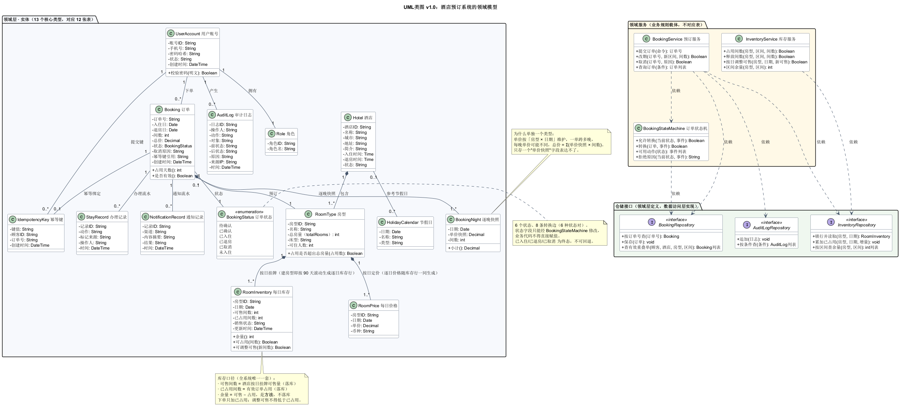

图 3-1　类图：酒店预订系统的领域模型（13 个核心类型 + 3 个领域服务 + 3 个仓储接口，对应 12 张表）

读图要点有三处：**订单与逐晚快照是一对多组合**（`Booking 1 *-- 1..* BookingNight`），因为总价必须能按晚追溯；**库存是"两个数"而不是"一个数"**（`RoomInventory` 有 `可售间数` 与 `已占用间数`，余量是方法不是字段）；**状态是枚举而不是自由字符串**，且只能经 `BookingStateMachine` 修改。

**为什么这样设计。** 早期版本只存一个"可售间数"，把占用当成"总房量 − 可售"反推出来。自查时发现这跟 REQ-003 冲突：酒店会因为维修把某天的挂牌量从 10 间调到 7 间，此时订单为 0，反推就会得出"已占用 3 间"——界面显示占用、对账报差异、减房校验误拒，全是假数据。所以改成两个独立事实：可售是酒店挂出来的量，已占用是订单压上去的量，余量才是两者之差。代价是每次查询多减一次，但换来的是"每个数字都有出处"。同理，单价快照不能放在订单头：价格按「房型 × 日期」维护，一张跨三晚的订单三晚单价可能都不同，一个字段装不下，必须逐晚一行。

#### 3.5.2　包图

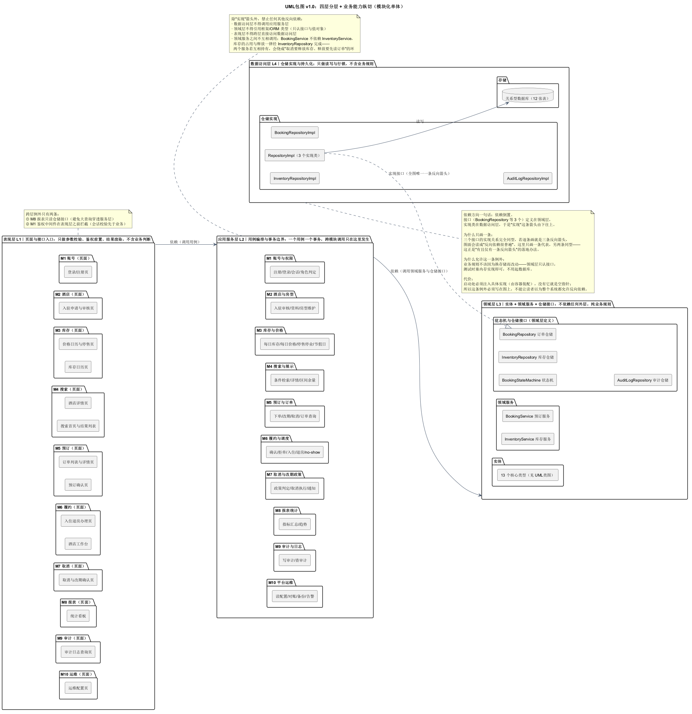

图 3-2　包图：四层分包 + 10 个业务模块纵切，全图唯一一条反向箭头是仓储实现

**为什么这样设计。** 包图要回答的问题是"谁能看见谁"。四层结构让"页面逻辑不下沉、业务规则不上浮"变成结构性约束；模块纵切则让每个模块有能力自己闭环一个用例。全图只有一条反向箭头（数据访问层实现领域层接口），这条箭头是有意留的，也是唯一允许的——如果把它去掉、改成"领域层依赖数据访问层"，业务规则就会绑死在 ORM 上；如果再多出第二条反向箭头，就说明分层已经被绕过，模块边界失效了。所以我把"反向箭头恰好一条"写成了机械判据，而不是靠人看图。

#### 3.5.3　组件图

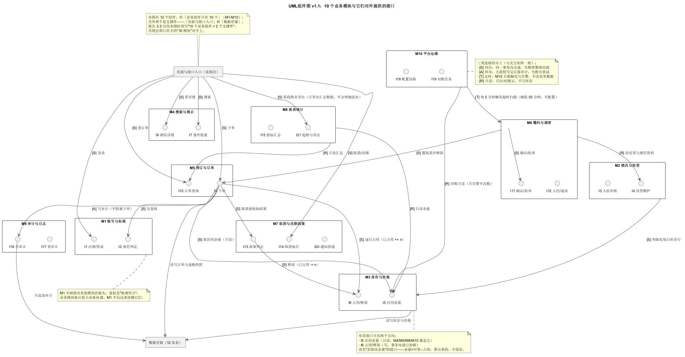

图 3-3　组件图：10 个业务组件 + 2 个支撑件，接口嵌在组件内，箭头标 S/A/T/R

**为什么这样设计。** 组件图不是包图的重复：包图讲"代码怎么分目录"，组件图讲"运行时谁调谁、用什么方式调"。所以每条箭头都标了 `[S] 同事务 / [A] 异步 / [T] 定时 / [R] 只读`——这四类连接决定了失败时怎么处理：S 失败必须整体回滚，A 失败可重试且不影响主流程，T 允许延迟，R 不允许写。接口画在组件内部而不是散在外面，是为了让"这个模块对外承诺了哪几个能力"一眼可数（M8 只有 I15、I21 两个，正是它有界职责的体现）。M1 不画指向其他模块的箭头，因为鉴权是"被调用方"，业务模块执行前主动来问 I2，M1 不反向依赖它们。

#### 3.5.4　用例图

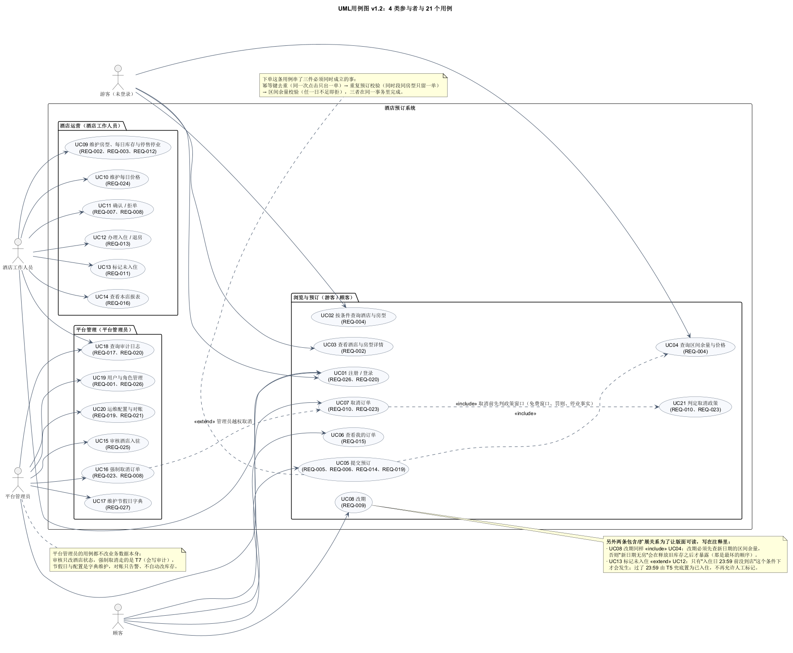

图 3-4　用例图：4 类参与者、21 个用例（每个用例标了 REQ 号）

**为什么这样设计。** 用例图的价值在于"谁在用"，所以参与者严格限定为四类，不引入"系统"当参与者（定时任务不是人，画进来会把用例图变成流程图）。每个用例后面标 REQ 号，是为了让"功能有没有漏"变成可机械核对的事：27 条 REQ 里除性能（REQ-018）与约束（REQ-022）这类非交互需求外，其余都能在图上找到落点。include 只画"必然发生"的（下单与改期都必须先查余量、取消必须先判政策），条件性发生的一律用 extend（未到店对入住、越权取消对顾客取消），这样读图的人不会把"可选路径"误读成"主流程"。

#### 3.5.5　状态图

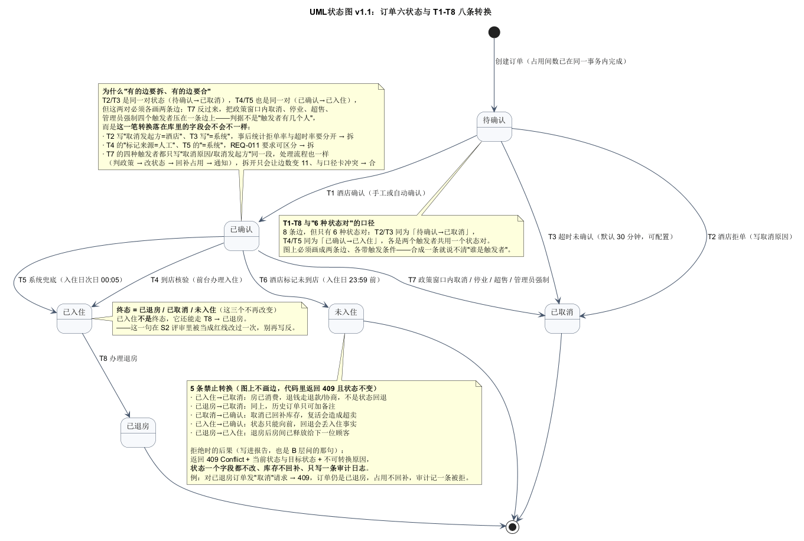

图 3-5　状态图：六状态、T1–T8 八条带触发的转换、5 条禁止转换写在注释里

**为什么这样设计。** 六个状态里有三个是"终态"（已退房 / 已取消 / 未入住），但**已入住不是终态**——它还能走 T8 到已退房，这一点我专门核对过，注释也写死在图上。八条边落在六种状态对上：待确认→已取消有两条（酒店拒单 T2、系统超时 T3），已确认→已入住有两条（前台核验 T4、系统次日兜底 T5）。之所以把"同一种状态对"拆成两条边，判据是**触发者与失败后果不同**：T2 由人触发、要写原因、要通知；T3 由定时任务触发、要防重复、要能批量；T4 是人工核验、当场失败；T5 是兜底、宁可多算一晚房费也不能把到店顾客判成未到店。如果合成一条，代码里就说不清"这一步到底谁触发的、失败该找谁"。

5 条禁止转换（已入住→已取消、已退房→已取消、已取消→已确认、已入住→已确认、已退房→已入住）**不画成边，而是写成注释并说明后果**：返回 409 + 当前状态 + 目标状态 + 不可转换原因，状态一个字段都不改、库存不回补，只写一条审计。把这些画成虚线边会让人以为"可以但要走特殊流程"，那是更危险的误读。

#### 3.5.6　活动图

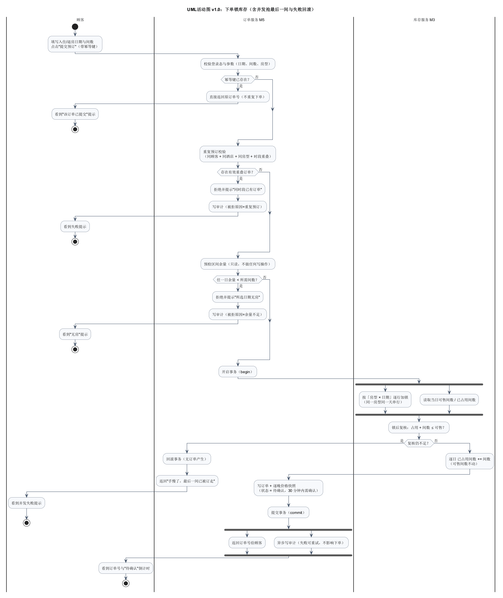

图 3-6　活动图：下单锁库存，三条泳道（顾客 / 订单服务 M5 / 库存服务 M3）

**为什么这样设计。** 活动图回答的是"一个请求从进来到出去，中间在哪个泳道里停过"。三条泳道的划分正好对应三次控制权转移：顾客提交 → M5 做幂等与重复预检 → M3 做加锁与占用。三个判定分别对应三类拒绝理由（幂等命中返回原单、存在重叠单、余量不足），每条拒绝路径都画了"写审计"和"回到顾客的提示"，因为"失败也要留痕"是 REQ-017 的要求。真正需要并发的只有一处：加锁与读取必须在同一临界区里顺序完成（先锁行、再读值），否则读到的是脏值；图上用顺序箭头而不是 fork 表达这一点，fork 只留给"返回订单号"与"异步写审计"——那才是真正互不依赖的两件事。

#### 3.5.7　时序图一：下单锁库存

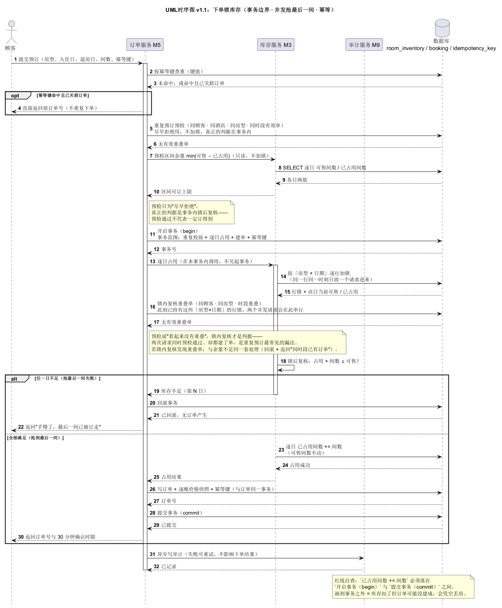

图 3-7　时序图：下单锁库存，五条生命线，事务从第 11 步开始到第 28 步提交

**为什么这样设计。** 时序图把"事务边界"这件事画成了可见的东西：`开启事务` 与 `提交事务` 之间只有"逐日占用 → 锁内复核重叠单 → 写订单 + 逐晚快照 + 幂等键"三件事，其余（幂等查重、重复预订预检、区间余量预检）全部在事务外，作为"尽早拒绝"的手段。这样安排的代价是正常的请求多查了一次库，收益是绝大多数无效请求不会进事务、不会占锁。锁内复核这一步是自查后补的：事务外的预检在并发下两个请求会同时通过，只有拿到行锁之后的复核才是判据。图右下角还写了一条红线自查——"`已占用间数 +=` 必须落在 begin 与 commit 之间"，这条既是给读者的提醒，也是自动检查脚本的判据。

#### 3.5.8　时序图二：超时取消

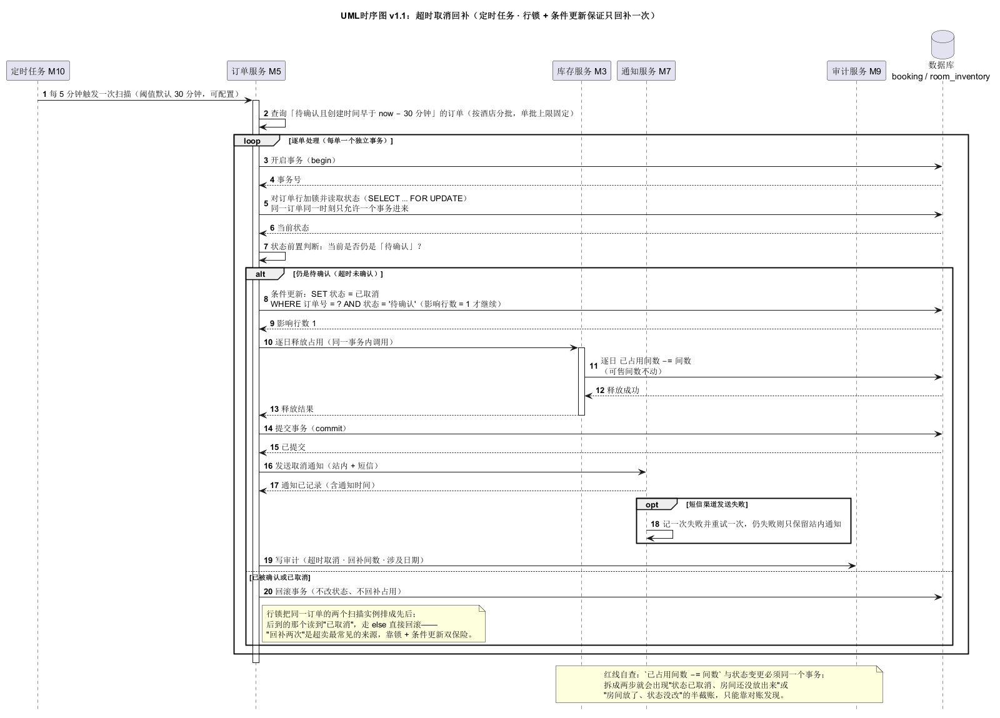

图 3-8　时序图：超时取消，M10 触发 → M6 扫描 → M5 逐单处理 → 状态机改状态 → M3 释放

**为什么这样设计。** 这张图修过两次，两次都是"看起来能跑、并发下会错"。第一版把"状态前置判断"当成幂等保证，全是 M5 自调用、没有数据库生命线——两个扫描实例同时跑就会双回补，而"回补两次"是超卖最常见来源。现在改成：M10 只负责触发（每 5 分钟一批），M6 负责扫描与逐单编排，M5 在事务内 `SELECT … FOR UPDATE` 锁住订单行，再经状态机生成条件更新 `WHERE 状态 = '待确认'`（影响行数 = 1 才继续），最后才让 M3 释放占用。行锁把两个实例排成先后，条件更新再兜一层——锁 + 条件更新双保险，比任何"应该不会并发"的假设都可靠。

### 3.6　设计理由汇总（一句话版）

| 决策 | 一句话理由 | 代价 |
|---|---|---|
| 模块化单体而非微服务 | 超卖=0 需要单库事务，拆服务会把并发窗口变成分布式窗口 | 单模块无法独立扩容 |
| 依赖倒置（仓储接口在领域层） | 换存储不改业务规则 | 启动需注入实现 |
| 库存两个数都落库 | 可售是挂牌量、占用是订单量，反推会把维修封房算成满房 | 每次查询多一次减法 |
| 逐晚快照单独成表 | 一单跨多晚单价不同，一个字段装不下 | 多一张表、写入多一步 |
| 幂等键与订单同事务写 | 先占位后回滚会留孤儿键，重试拿到不存在的订单号 | 冲突时要回滚重查 |
| 对账只告警不改库存 | 自动改库存等于让统计逻辑拥有写权限，出错无人复核 | 修正需要人工确认 |
| M10 不做界面 | 运维是配置与告警，不是业务流程 | 运维操作没有可视化入口 |

## 第4章　数据设计

### 4.1　表清单

12 张表，与类图的 13 个类型一一对应（`BookingStatus` 是枚举，不落表）。

表 4-1　数据表清单

| # | 表 | 作用 | 关键约束 |
|---|---|---|---|
| 1 | `user_account` | 账号、角色、密码哈希 | 手机号唯一 |
| 2 | `hotel` | 酒店资料与状态 | 酒店名唯一 |
| 3 | `room_type` | 房型、**总房量**、可住人数 | 同酒店内房型名唯一 |
| 4 | `room_inventory` | 每日库存：**可售间数 + 已占用间数 + 销售状态** | (房型, 日期) 唯一；`已占用 ≤ 可售 ≤ 总房量` |
| 5 | `room_price` | 每日价格（分/元、币种） | (房型, 日期) 唯一 |
| 6 | `booking` | 订单头：日期、间数、总价、状态、幂等键引用 | 订单号主键；有效状态内部分唯一 |
| 7 | `booking_night` | **逐晚价格快照** | (订单号, 日期) 唯一 |
| 8 | `idempotency_key` | 幂等键（键值唯一，指向订单） | 键值主键 |
| 9 | `stay_record` | 入住/退房办理记录 | 订单号 + 时间 |
| 10 | `audit_log` | 审计日志（只追加） | 保留 180 天 |
| 11 | `notification_record` | 通知与协商结果 | 订单号外键 |
| 12 | `holiday_calendar` | 节假日字典（平台级） | 日期唯一；**状态启用/停用**（只能停用，不物理删） |

> **与需求原文的一处偏离，需要说明**：REQ-027 的措辞是"维护（新增 / 修改 / 删除）节假日日期"。本设计把"删除"实现为**停用**，理由来自 REQ-027 自己的"异常与边界"——取消政策要按"下单当时"的日历集合追溯，如果物理删掉一行，历史订单上"当时为什么不可取消"就再也对不上账；而停用既能达到"以后不再命中"的业务效果，又保住了审计链。换句话说，这不是改了需求，而是把需求的边界条件（可追溯）优先于它的动词（删除）。

### 4.2　实体关系

`Hotel 1 — 1..* RoomType`（聚合）、`RoomType 1 — 1..* RoomInventory`（组合，按日一行）、`RoomType 1 — 1..* RoomPrice`（组合）、`Booking * — 1 RoomType`、`Booking 1 — 1..* BookingNight`（组合）、`Booking 1 — 1 IdempotencyKey`、`Hotel 1 — 0..* Booking`（用于本店隔离）、`Booking 1 — 0..* NotificationRecord`、`AuditLog` 与所有实体是弱引用（只记对象 ID，不加外键，避免主表删改影响日志）。

**为什么订单上冗余 `酒店ID`**：本店数据隔离（REQ-001/020）与按店统计（REQ-016）都要"从订单直接取酒店"，否则每次都要绕 `Booking → RoomType → Hotel` 两跳，既慢又容易在越权判断上写错。冗余的代价是要保证一致性，但因为房型归属酒店不变，这条冗余是安全的。

### 4.3　库存三值口径（全系统唯一一套）

- `余量 = 可售间数 − 已占用间数`（派生值，不落库）
- `区间可订上限 = min(某日余量)`（跨天订单的瓶颈日）
- **下单/释放只改 `已占用`**：`已占用 += n` / `已占用 -= n`，`可售` 不动
- **按日调整可售**：只改 `可售`，校验 `已占用 ≤ 新可售 ≤ 总房量`
- **改总房量 N → N′**：校验 `N′ ≥ 各日已占用`，通过后把各日可售钳制为 `min(可售, N′)`
- **对账**：比 `已占用` 与 `Σ(待确认/已确认/已入住 的订单间数)`，差异只告警

同一套口径在四个地方必须一致：`03 §5`、活动图、界面 03/11 的文案、时序图的消息。设计过程中曾经出现过"可售只存一个数、占用靠反推"与"下单只加占用"两套写法并存的情况，结果是界面上的占用成了算出来的假数（维修封房会被算成满房），这才把库存口径推倒重做了一遍。

### 4.4　唯一约束

表 4-2　唯一约束（6 条业务唯一 + 4 条技术性）

| 类型 | # | 约束 | 违反时 |
|---|---|---|---|
| 业务 | U1 | 手机号唯一 | 注册被拒，提示已注册 |
| 业务 | U2 | 酒店名称唯一 | 入驻/改名被拒 |
| 业务 | U3 | 同酒店内房型名唯一 | 建/改房型被拒 |
| 业务 | U4 | (房型, 日期) 库存唯一 | 同日建两行被拒 |
| 业务 | U5 | (房型, 日期) 价格唯一 | 同日两价被拒 |
| 业务 | U6 | 有效状态内 (顾客, 酒店, 房型, 时段) 部分唯一 | 重复预订被拒（提示已有单） |
| 技术 | T1 | 订单号唯一 | — |
| 技术 | T2 | 幂等键唯一 | 并发同键：回滚并返回原单 |
| 技术 | T3 | (订单号, 日期) 快照唯一 | 同晚两行被拒 |
| 技术 | T4 | 节假日日期唯一 | 重复登记被拒 |

**U6 的边界必须说清楚**：部分唯一索引只能拦住"起止日完全相同"的重复，**拦不住区间重叠**（11-15~11-17 与 11-16~11-18）。区间重叠只能靠应用层在「房型 × 日期」行锁之后做重叠查询——这也是时序图 3-7 里"锁内复核重叠单"那一步存在的原因。

### 4.5　对账（M10 每日任务）

两边独立算：左边读 `room_inventory.已占用间数`，右边按有效订单逐日汇总间数。差异 > 0 时输出差异清单（酒店、房型、日期、两边的值、涉及订单号）并告警，**不自动改库存**；修正需管理员确认后由 M3 执行并写审计。**不比对 `可售`**，因为酒店维修封房会让可售合法偏离总房量，比进来全是假告警。

## 第5章　非功能设计

表 5-1　四条非功能需求的落点

| REQ | 要求 | 设计落点 | 怎么验证 |
|---|---|---|---|
| REQ-018 性能 | 搜索 P95 ≤ 1.5s、下单 P95 ≤ 2s、200 并发、错误率 < 0.5% | 搜索只读 C 端缓存 + `(房型,日期)` 索引；下单走行锁 + 单事务，避免多次往返 | 压测脚本按 200 并发打搜索/下单；P95 与错误率出报表 |
| REQ-019 一致性 | 任意并发下超卖次数 = 0 | 逐日行锁 + `已占用 + n ≤ 可售` 复核 + U6 部分唯一 + 每日对账（只告警） | 并发抢最后一间用例：N 个请求只 1 单成功；对账差异清单为空 |
| REQ-020 安全与隔离 | 越权 403、加盐哈希、HTTPS | M1 鉴权中间件前置 + 数据归属判断（顾客→本人订单、酒店→本店）+ 密码加盐哈希 + 传输加密 | 权限矩阵逐项打 403；哈希抽样检查；HTTPS 配置检查 |
| REQ-021 可用性 | 季度可用性 ≥ 99.5%、RTO ≤ 30min | 无状态应用可多实例、单库每日备份 + 增量、故障切换脚本化 | 演练：停实例、恢复库，计时 RTO |

### 5.1　"超卖 = 0"是怎么保证的

四道闸门，缺一不可：

1. **逐日行锁**：按「房型 × 日期」加锁，同一房型同一天串行。
2. **锁内复核**：拿到锁后重新读 `已占用`，判断 `已占用 + n ≤ 可售`，不足即回滚。
3. **唯一索引兜底**：U6 拦住"起止日完全相同"的重复单；同键并发由 T2 主键冲突兜住（回滚后返回原单）。
4. **对账兜底**：每日比对占用与订单汇总，差异告警——这是"万一前三道都漏了"的最后一道，且**只告警不改数**，避免自动修正把错误掩盖成正常。

### 5.2　失败与降级

- 通知服务不可用：主流程不受影响（异步、可重试），界面提示"通知可能延迟"。
- 报表查询超时：M8 只读，超时返回兜底空态，不影响下单。
- 对账任务失败：只影响告警，不影响交易；任务本身幂等，可重跑。
- 数据库主从切换：写走主库，读可降级到主库（牺牲读性能保正确性）。

## 第6章　界面设计

### 6.1　设计规范

- **画布**：1440×900 设计，导出 2880×1800（@2x），17 张统一尺寸，便于并排比较。
- **色与徽标**：六状态各一色（待确认琥珀、已确认蓝、已入住绿、已退房灰、已取消紫、未入住红），全站不出现"同一状态两种颜色"。
- **动作可见性**：列表页**直接隐藏**不可执行的动作（列表要扫得快）；详情页**置灰并写明原因**（用户已经点进来，需要知道动作存在、当前不可用以及为什么）。两种都不靠"点了才报错"。
- **错误提示**：一律就地提示（输入框下红字）或页顶红条，不清空已填内容、不弹窗打断。
- **每张图的页脚**：`模块 · REQ · 界面号`，让"这张图证明哪条需求"可核对。

### 6.2　界面与需求映射

表 6-1　17 张界面与模块、需求的对应

| 界面 | 页面 | 所属模块 | 覆盖 REQ |
|---|---|---|---|
| 界面01 | 登录 / 注册 | M1 账号与权限 | REQ-026、REQ-020 |
| 界面02 | 搜索首页 | M4 搜索与展示 | REQ-001 |
| 界面03 | 结果列表 | M4 搜索与展示 | REQ-001、REQ-004 |
| 界面04 | 酒店详情 | M2 酒店与房型 / M4 | REQ-001、REQ-004 |
| 界面05 | 预订确认 | M5 预订与订单 | REQ-005、REQ-006 |
| 界面06 | 提交结果 | M5 预订与订单 | REQ-005、REQ-014 |
| 界面07 | 我的订单 | M5 预订与订单 | REQ-015 |
| 界面08 | 订单详情（含取消/改期入口） | M5 / M7 取消与改期政策 | REQ-009、REQ-010、REQ-015 |
| 界面09 | 取消确认（弹窗） | M7 取消与改期政策 | REQ-010 |
| 界面10 | 酒店工作台 | M6 履约与调度 | REQ-007、REQ-011 |
| 界面11 | 库存日历 | M3 库存与价格 | REQ-003、REQ-012 |
| 界面12 | 价格日历与停售 | M3 库存与价格 | REQ-024、REQ-012、REQ-023 |
| 界面13 | 入住 / 退房办理 | M6 履约与调度 | REQ-013、REQ-011 |
| 界面14 | 入驻申请与审核 | M2 酒店与房型 | REQ-025 |
| 界面15 | 节假日日期表维护 | M3 库存与价格 | REQ-027 |
| 界面16 | 统计看板 | M8 报表统计 | REQ-016 |
| 界面17 | 审计日志查询 | M9 审计与日志 | REQ-017 |

### 6.3　几个关键界面的设计取舍

**库存日历（界面 11）** 是这套设计里信息密度最高的一页：每个格子同时给 `可售 / 已占用 / 余量`，因为酒店要判断"能不能再卖"必须看三个数的关系，只看余量会误以为"还有 2 间可以随便加可售"。改可售低于已占用时当场拒绝并回显占用数，而不是提交后报错——拒绝的理由必须和数字一起出现。

**入住退房（界面 13）** 的核心是时间窗：no-show 按钮在入住日 23:59 之后置灰并写明"系统将于次日 00:05 自动置为已入住"。这里刻意选了"宁可多算一晚房费也不误判顾客没来"，因为误判 no-show 会直接导致顾客到店无房，代价比一晚房费高得多。

**统计看板（界面 16）** 只读，并把口径直接印在界面上（入住率 = 已住间夜 ÷ 可售间夜，可售按每日挂牌量算）。统计口径写在界面上而不是只写在文档里，是因为"这个数怎么来的"是使用者第一个会问的问题；导出只给汇总，不发明细，明细导出列为后续可做项，本次不做。

**审计日志（界面 17）** 把三条硬约束（只追加、180 天、越权 403）做成页面上的三张卡，而不是藏进帮助文档。审计页最怕使用者以为"能改"，写在最显眼的地方比写在手册里有效。

<!-- BEGIN 6.4 界面描述（脚本生成，勿手改） -->

### 6.4　十七个界面的功能描述

下面每一条都对应 `UI界面/界面说明.md` 里的一行，写法统一为「谁能看到 → 在哪儿 → 有什么 → 怎么走 → 出错怎么办」，图与表不再各自为政。前四张（03 结果列表、05 预订确认、11 库存日历、17 审计日志）在正文里直接嵌图。

#### 界面01　登录 / 注册

- **谁用、从哪儿进**：三种角色共用；顶栏「登录」（M1 账号与权限，REQ-026、REQ-020）。
- **页面上有什么**：双栏品牌页、手机号 + 密码 + 图形验证码、登录/注册切换、记住设备、403 说明条。
- **主流程**：手机号登录 → 角色判定 → 跳对应端首页。
- **异常与边界**：「验证码已过期，请点击图形刷新」就地提示；「连续 5 次失败锁定 10 分钟」；「无权访问该资源」（403）。

#### 界面02　搜索首页

- **谁用、从哪儿进**：游客 / 顾客；导航「搜索酒店」（M4 搜索与展示，REQ-001）。
- **页面上有什么**：搜索条（目的地、入住、退房、房间/人数）、热门城市、3 张推荐酒店卡（带「仅剩 2 间」）。
- **主流程**：填条件 → 搜索 → 进结果列表。
- **异常与边界**：「退房日期必须晚于入住日期」就地提示、不清空已选；跨年跨月按自然日。

#### 界面03　结果列表

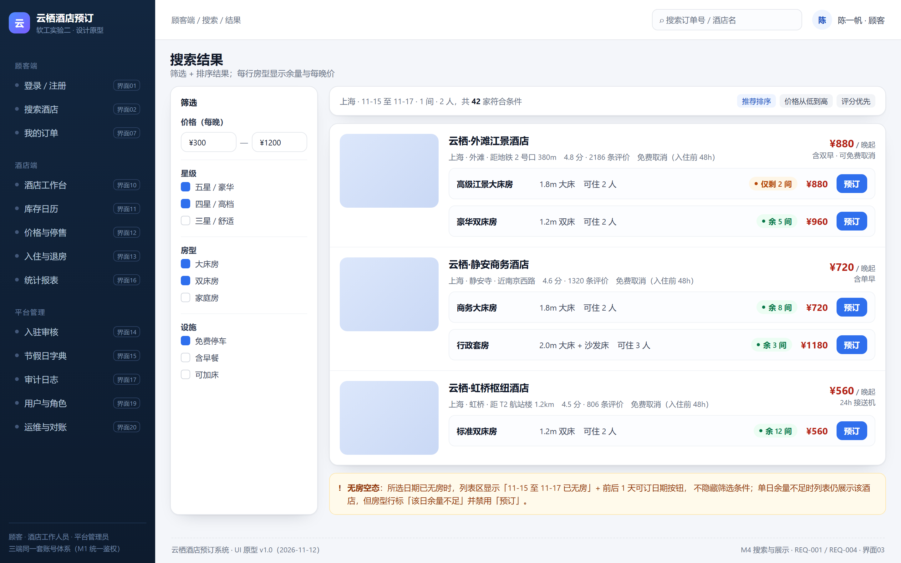

图 6-1　界面 03 结果列表：每行房型带余量与「预订」按钮，无房时给替代日期而不是空白页

- **谁用、从哪儿进**：顾客；首页搜索后（M4 搜索与展示，REQ-001、REQ-004）。
- **页面上有什么**：左侧筛选（价格、星级、房型、设施）、右侧结果行（每行房型带余量徽标与预订按钮）、排序。
- **主流程**：筛选/排序 → 选房型 → 预订或看详情。
- **异常与边界**：无房空态「11-15 至 11-17 已无房」+ 前后 1 天的可订按钮，不隐藏筛选条件；单日余量不足仍展示并禁用「预订」。

#### 界面04　酒店详情

- **谁用、从哪儿进**：顾客；结果行点击（M2 酒店与房型 / M4，REQ-001、REQ-004）。
- **页面上有什么**：图片画廊、房型表（**可售 12 / 已占用 10 / 余量 2** 三列）、逐晚价格提示、政策与提示。
- **主流程**：选房型 → 预订 → 进预订确认。
- **异常与边界**：「仅剩 2 间」「余 5 间」「已订满」三种状态徽标；停售写「暂停销售」而非「已订满」；抢最后一间失败回显余量 0。

#### 界面05　预订确认

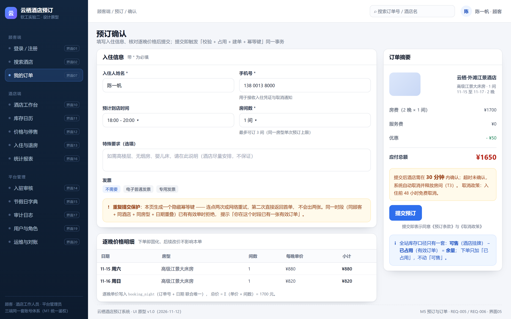

图 6-2　界面 05 预订确认：右侧摘要 + 30 分钟倒计时 + 重复提交保护说明，左侧逐晚价格只读

- **谁用、从哪儿进**：顾客；详情页「预订」（M5 预订与订单，REQ-005、REQ-006）。
- **页面上有什么**：入住信息表单（姓名、手机、到店时间、房间数、特殊要求、发票）、右侧订单摘要（房费/服务费/优惠/应付 ¥1650）、30 分钟确认倒计时、重复提交保护说明。
- **主流程**：填信息 → 提交预订 → 事务内「占用 + 建单 + 写幂等键」→ 进提交结果。
- **异常与边界**：「同一时段已有有效订单」拒绝；「最多可订 3 间」上限提示；**本页不留存任何价格输入**，价格只读。

#### 界面06　提交结果

- **谁用、从哪儿进**：顾客；下单成功后（M5 预订与订单，REQ-005、REQ-014）。
- **页面上有什么**：成功卡 + 订单号 HT20261112000318 + 「待确认」徽标 + 确认剩余 29:41 + 三个后续动作按钮 + 「你可能还关心」三问答。
- **主流程**：查看订单详情 / 继续浏览 / 联系酒店。
- **异常与边界**：重复提交返回同一订单号（幂等键同事务写入）；提交失败不在此页，而是回确认页顶部红条「手慢了，最后一间已被订走（当前余量 0）」并保留填写内容。

#### 界面07　我的订单

- **谁用、从哪儿进**：顾客；导航「我的订单」（M5 预订与订单，REQ-015）。
- **页面上有什么**：按状态分组的 tab（全部/待确认/已确认/已入住/历史）、5 行订单、每行只显示该状态可做的动作、状态说明卡、空态卡。
- **主流程**：选 tab → 看行 → 详情 / 取消 / 改期 / 查看凭证 / 再次预订。
- **异常与边界**：空态「还没有订单 —— 去『搜索酒店』看看，或者检查一下筛选的日期范围」；不可做的动作**不显示**而不是置灰。

#### 界面08　订单详情（含取消/改期入口）

- **谁用、从哪儿进**：顾客；订单行「详情」（M5 / M7 取消与改期政策，REQ-009、REQ-010、REQ-015）。
- **页面上有什么**：状态时间线（待确认→已确认→待入住→已入住→已退房）、订单明细（酒店、房型、入住退房、入住人、状态、取消政策、总价）、逐晚价格表、可执行操作条、右侧「改期怎么算」四步。
- **主流程**：取消 → 进取消确认；改期 → 选新日期。
- **异常与边界**：「标记未入住」置灰并说明「那是酒店工作人员的权限（REQ-011），越权调用接口返回 403」；no-show 时间窗写在时间线下方：**23:59 前**酒店可标记「未入住」，此后系统于**次日 00:05 自动置为「已入住」**；不可执行的动作必须给出原因，不能只置灰。

#### 界面09　取消确认（弹窗）

- **谁用、从哪儿进**：顾客；详情页「取消订单」（M7 取消与改期政策，REQ-010）。
- **页面上有什么**：遮罩弹窗、已支付 ¥2480、取消手续费 ¥0（距入住 8 天，免费取消期内）、预计退款、取消原因选择、「暂不取消 / 确认取消并退款」。
- **主流程**：确认 → 同事务「改状态 + 释放已占用」→ 回详情。
- **异常与边界**：「取消后房间立即释放」（提示别人马上能订到）；「不可取消区间：11-14 至 11-16（展会期间）的订单不支持取消，页面直接隐藏取消按钮并提示『该订单处于不可取消区间，如需取消请联系酒店』」——不靠点击后报错。

#### 界面10　酒店工作台

- **谁用、从哪儿进**：酒店工作人员；导航「酒店工作台」（M6 履约与调度，REQ-007、REQ-011）。
- **页面上有什么**：4 个统计块（待确认/今日入住/今日退房/本店今日余量）、待确认队列（按剩余确认时间升序 + 确认/拒单）、今日入住退房摘要、超时预警卡。
- **主流程**：看队列 → 确认或拒单；到店 → 去界面13 办理。
- **异常与边界**：「剩 04:12」倒计时；超时未确认 → 状态转已取消（T3）、**已占用间数 −= 间数**、发站内+短信；整批扫描由 M10 每 5 分钟触发。

#### 界面11　库存日历

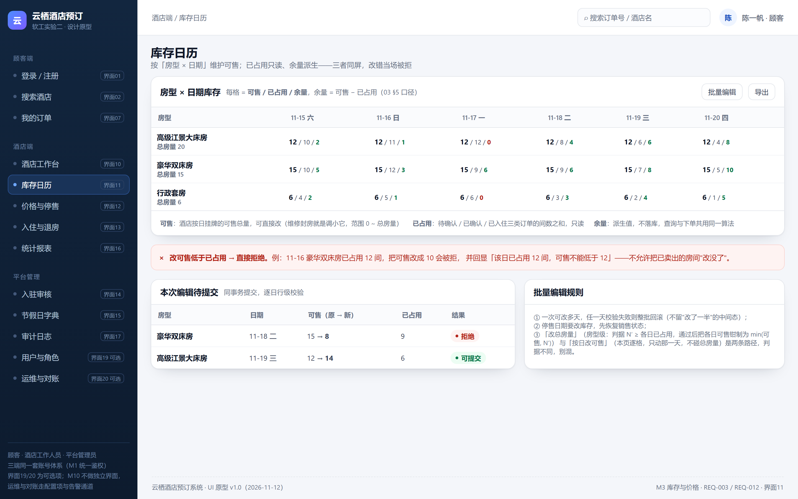

图 6-3　界面 11 库存日历：每格「可售 / 已占用 / 余量」三值同屏，改可售低于已占用当场被拒

- **谁用、从哪儿进**：酒店工作人员；导航「库存日历」（M3 库存与价格，REQ-003、REQ-012）。
- **页面上有什么**：房型×日期矩阵，每格 **可售 / 已占用 / 余量** 三值；「本次编辑待提交」表（原→新、已占用、结果）；批量编辑规则卡。
- **主流程**：改可售 → 行级校验 → 同事务提交。
- **异常与边界**：**改可售低于已占用 → 直接拒绝**并回显「该日已占用 12 间，可售不能低于 12」；任一天失败整批回滚；停售日期要改库存先恢复销售。

#### 界面12　价格日历与停售

- **谁用、从哪儿进**：酒店工作人员；导航「价格与停售」（M3 库存与价格，REQ-024、REQ-012、REQ-023）。
- **页面上有什么**：房型×日期价格矩阵、单房型停售开关、整店停业入口、不可取消区间（只读，来自节假日表）。
- **主流程**：逐日改价 / 停售 / 停业（二次确认）。
- **异常与边界**：改价**只影响新单**，已确认订单按 `booking_night` 快照结算；停售写「暂停销售」而不是「已订满」；停业前先列出受影响订单数与间夜数，已确认单须逐单协商（REQ-023）。

#### 界面13　入住 / 退房办理

- **谁用、从哪儿进**：酒店工作人员（前台）；导航「入住与退房」（M6 履约与调度，REQ-013、REQ-011）。
- **页面上有什么**：核对订单（订单号或手机号后四位）、核对结果卡、办理入住（T4）/ 办理退房（T8）/ 标记未入住（T6）三动作卡。
- **主流程**：核验 → 办理入住或退房。
- **异常与边界**：状态非「已确认」→ 409 并显示当前状态，库存不变；**「标记未入住」过了入住日 23:59 置灰**并说明「系统将于次日 00:05 自动置为已入住（T5）」。

#### 界面14　入驻申请与审核

- **谁用、从哪儿进**：平台管理员；导航「入驻审核」（M2 酒店与房型，REQ-025）。
- **页面上有什么**：申请列表（酒店/等级/提交时间/状态）、资料详情（执照、消防、房型房量、联系人、结算账户）、审核意见（通过/驳回/补充材料）。
- **主流程**：看资料 → 提交结论 → 通过后自动建账号与 90 天库存行。
- **异常与边界**：驳回或补充材料**必填理由**；通过后按总房量建每日库存行（幂等，重复点不出重复行）；审核只改酒店状态与账号，不动业务数据。

#### 界面15　节假日日期表维护

- **谁用、从哪儿进**：平台管理员；导航「节假日字典」（M3 库存与价格，REQ-027）。
- **页面上有什么**：区间列表（开始/结束/名称/默认政策/状态、**动作只有「编辑 / 停用」没有「删除」**）、新增区间表单、日历对照条。
- **主流程**：新增/编辑区间 → 即刻生效。
- **异常与边界**：**日期重复 → 拒绝并高亮冲突行**，提示「与『元旦』重叠」；**被历史订单引用过的区间不能物理删，只能停用**（取消政策按「下单当时」的日历集合追溯，删行会让历史的「当时为什么不可取消」查不到）；改动即刻影响顾客端「不可取消区间」与价格日历默认政策。

#### 界面16　统计看板

- **谁用、从哪儿进**：酒店工作人员 / 平台管理员；导航「统计报表」（M8 报表统计，REQ-016）。
- **页面上有什么**：本店/全平台切换、4 个 KPI（入住率/订单量/取消率/RevPAR）、按日趋势柱状图、指标口径卡、导出（I21）。
- **主流程**：切视角与区间 → 看指标 → 导出汇总。
- **异常与边界**：全页**只读**；导出只有**汇总数据**（I15 汇总 → I21 趋势与导出），不含逐条订单明细；无数据时空态写明区间无成交并给口径，不画 0 的假趋势。

#### 界面17　审计日志查询

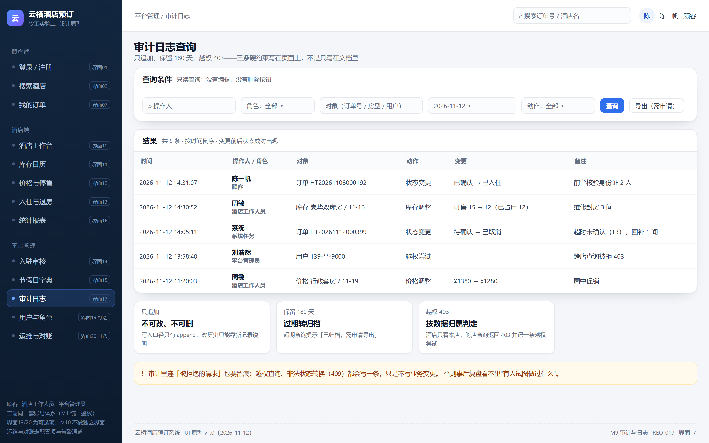

图 6-4　界面 17 审计日志：只追加、保留 180 天、越权 403 三条硬约束写在页面上

- **谁用、从哪儿进**：平台管理员；导航「审计日志」（M9 审计与日志，REQ-017）。
- **页面上有什么**：查询条件（操作人/角色/对象/日期/动作）、结果表（时间/操作人/对象/动作/变更前后/备注）、三条硬约束卡。
- **主流程**：设条件 → 查询 → 导出（需申请）。
- **异常与边界**：**只追加不可改不可删**；**保留 180 天**，超期提示「已归档，需申请导出」；**越权 403**（酒店只看本店，跨店查询被拒并记一条越权尝试）；被拒绝的请求（越权、409）也留痕。

<!-- END 6.4 界面描述 -->

### 6.5　三种"没东西"不是一回事

| 情形 | 用户看到什么 | 给不给重试 | 落点 |
|---|---|---|---|
| 空态：条件成立但没有数据 | 说清"哪段时间没房" + 替代路径（换日期/换酒店） | 不给，重试也还是没房 | 界面 03 底部、界面 07 空态 |
| 错误态：请求失败 | 红条"加载失败，点击重试" | 必须给，已填条件不能丢 | 界面 03、05 |
| 不可用态：有数据但当前不能操作 | 置灰 + 原因（无权限/停售/不在可取消区间） | 不给，重试也没用 | 界面 07 动作列、界面 08「标记未入住」 |

这条分界的判据只有一句：**重试有没有意义**。原稿把三者都写成"异常文案"，结果界面 03 的空态写成了策略说明，用户看不出"现在到底是哪一种"。

### 6.6　与需求的可追溯

17 张界面覆盖 M1–M9 九个业务模块，**每个模块至少一张只属于自己的界面**（M2 用 14、M3 用 11/12/15、M6 用 10/13、M8 用 16、M9 用 17），M10 不设独立界面——它的职责是配置与告警，没有面向用户的业务动作。界面 18–20（用户管理、运维配置、通知记录）列为可选项，本轮不做，报告里如实标注，不冒充已交付。

## 第7章　AI 辅助设计过程

> 本章由 S8 撰写：按"一次一记录"写使用场景、输入、原样结果、发现的问题、人工改后、工具优缺点，素材来自 S1–S6 的自查与同学互看记录。本节先留结构，正文在 S8 补齐。

## 第8章　关于 AI 参与软件设计的思考

> 本章由 S8 撰写：回答两个问题——大模型如何辅助软件设计；能否设计一套让人只做检查校对的工作流。本节先留结构，正文在 S8 补齐。

## 附录 A　需求条目全文（REQ-001 ~ REQ-027）

**REQ-001　用户角色划分与权限隔离**（功能需求）

系统区分顾客、酒店工作人员、平台管理员三类用户；未登录游客只能查询酒店与余量，不能下单。

> 异常与边界：酒店工作人员访问其他酒店数据、顾客访问他人订单，返回 403 并写入日志；游客发起下单返回未授权且不产生订单。

**REQ-002　酒店与房型基础信息管理**（功能需求）

酒店工作人员可维护本酒店的名称、地址、联系电话、简介，以及房型的名称、床型、面积、可住人数（最大入住人数）。

> 异常与边界：必填项为空、面积或可住人数非正整数时拒绝保存并提示字段；酒店不能修改其他酒店的信息。

**REQ-003　每日库存维护**（功能需求）

酒店按「房型 × 日期」维护每日可售间数；允许增加库存，减少时不得低于该日已有有效订单占用的间数。

> 异常与边界：减房后低于该日已占用间数时，拒绝该次修改并提示当前已占用间数；为已停售日期设置库存须先恢复销售。

**REQ-004　多条件查询与余量展示**（功能需求）

按城市、入住日期、退房日期、人数、房型、价格范围组合查询，只返回所选日期段内有房且房型可住人数不小于查询人数的房型，并显示剩余可订间数。剩余可订间数 = 所选区间内每一天「该日可售库存 − 该日有效订单占用间数」的最小值；该口径与 REQ-019 的库存核对口径一致，查询与下单共用。

> 异常与边界：退房日期不晚于入住日期、日期早于当前日期时拒绝查询并提示；无匹配结果返回空列表而非错误；区间的每一天都必须有房才算该房型可订。

**REQ-005　下单与库存锁定（提交即占住）**（功能需求）

顾客提交订单即锁定所选房型在入住日至退房日前一天每一天的库存，订单进入「待确认」；酒店须在 30 分钟内确认，超时由系统定时任务自动取消并释放库存。30 分钟为默认确认期限，须支持系统配置（便于测试与运营调整）。

> 异常与边界：多人同时预订最后一间时，仅第一个请求成功，其余返回「库存不足」且不留任何订单；库存扣减过程中任一环节失败须整单回滚，不得产生半张订单；锁定后 30 分钟内未确认自动转「已取消」并回补库存；重复预订校验（REQ-014）与库存扣减须在同一事务内完成，校验通过后扣减失败须整体回滚，不得出现「校验通过但未扣减」的中间状态。

**REQ-006　订单金额计算与价格快照**（功能需求）

订单金额按每日价格乘以间数后逐日累加；下单时固化每日价格快照，此后酒店调整价格不影响已生成订单。

> 异常与边界：所选区间存在未设置价格的日期时拒绝下单并提示缺失日期；跨月订单同样按日累加，不做整段一口价。

**REQ-007　酒店确认与拒单**（功能需求）

酒店工作人员可对本店的「待确认」订单执行确认或拒单；拒单须填写原因，订单转「已取消」并回补库存。

> 异常与边界：超过 30 分钟已被自动取消的订单，酒店再确认须失败并提示「订单已超时取消」；对非「待确认」订单执行确认或拒单返回 409 且订单状态不变。

**REQ-008　订单状态机与状态转换限制**（功能需求）

订单包含待确认、已确认、已入住、已退房、已取消、未入住（no-show）六个状态；仅允许以下转换：待确认→已确认／已取消；已确认→已入住／已取消／未入住；已入住→已退房。其余转换一律禁止。

> 异常与边界：明确禁止「已入住→已取消」「已退房→已取消」「已取消→已确认」「已入住→已确认」「已退房→已入住」；任何非法转换返回 409、订单状态不变，并写入审计日志。

**REQ-009　订单改期**（功能需求）

顾客可修改订单的入住与退房日期，但不允许更换房型、不允许修改间数；每单改期最多 2 次；已入住后仅允许提前退房，不允许延长住宿。

> 异常与边界：新日期区间任一晚库存不足时整单失败，订单与库存均保持原状，提示不可用的具体日期；改期第 3 次被拒绝；已入住订单改期须拒绝。

**REQ-010　取消政策与取消执行**（功能需求）

依据平台统一维护的节假日日期表区分普通订单与节假日订单，按入住日的提前时长执行取消阶梯：普通订单入住前 72 小时（含）以上免费取消，72 至 24 小时收取首晚房费 50%，24 小时内不可取消；节假日订单入住前 48 小时（含）以上免费取消，48 小时内不可取消。顾客取消须选择原因。

> 异常与边界：落在「不可取消」区间的订单取消请求须被拒绝并提示原因；已入住、已退房、已取消订单不可再取消；节假日表由平台统一维护（REQ-027），酒店不可覆盖；判定所用节假日口径按下单时的快照，后续维护节假日表不改变历史订单的判定；超时自动取消的订单不适用本阶梯。

**REQ-011　未入住（no-show）标记**（功能需求）

酒店须在入住日 23:59 前将「已确认」且未到店的订单标记为未入住；逾期未标记的，系统在次日将订单视为「已入住」，一期不做扣费与信用限制。

> 异常与边界：已取消订单不可标记未入住；同一订单重复标记须返回 409；跨零点未标记的订单由系统任务自动转「已入住」，此转换不得再由人工撤销；系统自动转「已入住」时须记录标记人为「系统」、备注为「系统默认」，与酒店人工标记（记录操作人）在订单详情与日志中可区分展示。

**REQ-012　房型停售与整店停业**（功能需求）

酒店可对「房型 × 日期」设置停售，也可设置整店停业的日期段；停售与停业期间不接受新订单；已确认订单保留，由酒店协商取消并通知顾客，取消路径与酒店原因取消一致。停业须记录停业原因、停业通知发出时间、协商结果（顾客同意取消／顾客保留原订单）三项信息。

> 异常与边界：停业期间已存在的「待确认」订单由系统直接取消并回补库存；「已确认」订单不受影响但需通知并记录协商结果；恢复销售后可再次接单，历史停售与停业记录保留。

**REQ-013　入住与退房办理**（功能需求）

酒店工作人员凭订单号或入住人手机号核验订单并办理入住、退房；每次办理须记录操作人、操作时间与订单号。

> 异常与边界：非入住日办理入住须拒绝并提示；对「已退房」订单重复办理退房返回 409；对「已取消」「未入住」订单办理入住须拒绝；核验失败时提示未找到订单。

**REQ-014　重复预订与重复提交拦截**（功能需求）

同一顾客在同一酒店、同一时段、同一房型不得存在两条有效订单（有效指「待确认」「已确认」「已入住」三种状态）；服务端以幂等键识别重复提交，重复请求返回已有订单而不新建。

> 异常与边界：同一顾客同时段预订同一酒店的不同房型是允许的；日期区间部分重叠即视为重复；一单可包含多间房，重复判定按房型而非按间数；顾客在住期间不得对同一房型再下单，续订场景一期不支持，须先退房再新订。

**REQ-015　订单列表与详情**（功能需求）

顾客侧与酒店侧订单列表支持按状态与日期段筛选；订单详情显示状态、金额明细、待确认剩余时间，以及取消、拒单、超时、停业等处理原因。

> 异常与边界：剩余时间归零后详情须反映「已取消（超时未确认）」；订单详情除待确认倒计时外，其余展示须与订单实际状态一致；筛选条件无结果返回空列表。

**REQ-016　统计与汇总**（功能需求）

系统统计入住率与订单量；入住率等于已入住间夜数除以可售间夜数，按日统计并可按月汇总；订单量按状态分别计数。酒店工作人员只能查看本酒店数据，平台管理员可查看全平台数据。

> 异常与边界：可售间夜为 0 时入住率显示 0 且不出现除零错误；被取消与未入住订单不计入已入住间夜。

**REQ-017　关键操作日志**（功能需求）

记录预订、确认、拒单、取消、改期、入住、退房、停售、停业、强制取消、价格修改、节假日表修改、入驻审核等关键操作，字段包含操作人、角色、时间、对象 ID、动作、变更前后状态；日志只追加不可修改，保留 180 天，仅平台管理员可查询。

> 异常与边界：操作失败也要记录失败原因与结果，但不得记录变更后状态；日志不得提供删除或编辑入口；查询无结果返回空列表。

**REQ-018　性能**（非功能需求）

在 200 并发用户、节假日预订高峰数据量下，酒店与房型搜索接口的 P95 响应时间不超过 1.5 秒；下单接口的 P95 响应时间不超过 2 秒；整体请求错误率低于 0.5%。

> 异常与边界：压测中出现错误率超过 0.5% 或 P95 超标即判为不达标；在此并发下超卖次数必须同时为 0（见 REQ-019）。

**REQ-019　不超卖与库存一致性**（非功能需求）

任意并发条件下，任一房型任一日期的有效订单间数之和不得超过该日可售库存，超卖次数必须为 0；库存扣减失败须整单回滚、不得产生半张订单；改期、取消、超时释放后库存与订单状态须即时一致，出现不一致时由对账任务发现并告警。

> 异常与边界：数据库或服务在扣减中途中断后，对账任务须能发现差异并输出可定位的订单号与日期；回补失败须写入异常日志并参与每日对账。

**REQ-020　安全与数据隔离**（非功能需求）

顾客只能访问本人订单，酒店工作人员只能访问本酒店数据，越权请求一律返回 403；用户口令加盐哈希存储且不可逆；全站使用 HTTPS 传输。

> 异常与边界：通过修改 URL 参数或请求体伪造他人订单号、其他酒店 ID 时，同样返回 403 且不泄露目标数据是否存在；凭据失效或过期返回 401。

**REQ-021　可用性与故障恢复**（非功能需求）

系统季度可用性不低于 99.5%；发生故障后的恢复时间目标（RTO）不超过 30 分钟。

> 异常与边界：计划内维护若占用可用性时间须提前记录；恢复超过 30 分钟即为不达标。

**REQ-022　一期不实现的业务范围**（约束）

一期不实现在线支付与退款、用户评价、会员积分、优惠券、连锁集团多店统一管理、酒店内部 OA 财务人事；所有金额仅用于展示与记账，实际结算在到店或线下完成；取消与未入住不设违约金、不限制再次预订。

> 异常与边界：酒店或顾客提出上述需求时，答复为二期规划，不在一期范围。

**REQ-023　酒店原因取消已确认订单的处理**（功能需求）

酒店因停业或超售等原因取消已确认订单时，一期不设任何补偿（无免费升级、无平台补偿券、无赔偿），仅执行全额退订：订单转「已取消」（原因为酒店原因／停业），记录取消原因，生成并保存通知记录，库存回补，订单保留可查询。

> 异常与边界：取消原因必填，未填则拒绝该操作；对非「已确认」订单发起本操作返回 409；取消后不得产生任何费用或补偿记录；同一订单重复取消返回 409。

**REQ-024　每日价格维护**（功能需求）

酒店工作人员按「房型 × 日期」维护每日价格，支持新增、修改与查询；价格变更只影响此后生成的新订单，已生成订单按 REQ-006 的价格快照计算，不随修改变化。

> 异常与边界：价格为零或负数、超出上限时拒绝保存；缺少某日价格的房型该日不可下单（与 REQ-006 衔接）；修改已过日期的价格不影响历史订单。

**REQ-025　酒店入驻审核**（功能需求）

酒店提交入驻申请（名称、地址、联系电话、简介）后，由平台管理员审核通过或拒绝（拒绝须填写原因）；审核通过时由管理员创建该酒店的工作人员账号。未通过审核的酒店不出现在顾客查询结果中。

> 异常与边界：酒店名称重复时提示已存在并拒绝重复申请；拒绝未填原因时不允许提交；审核通过后重复创建同名酒店须拒绝；未审核通过的酒店登录被拒绝。

**REQ-026　注册与登录**（功能需求）

顾客可自助注册并登录；酒店工作人员账号由入驻审核通过时创建，不开放自助注册；平台管理员账号由系统预置；未登录游客无需账号即可查询酒店与余量。

> 异常与边界：登录失败提示不区分「账号不存在」与「密码错误」（防账号枚举）；重复注册同一手机号或账号被拒绝；游客下单被拒绝并引导登录。

**REQ-027　节假日日期表维护**（功能需求）

平台管理员维护节假日日期表（新增、删除日期），供 REQ-010 的取消阶梯判定使用；维护操作写入日志。

> 异常与边界：删除正在被订单引用的节假日日期时，已生效订单的取消判定不受影响（判定基于下单时快照，避免历史订单被改判）；重复添加同一日期须提示已存在。

